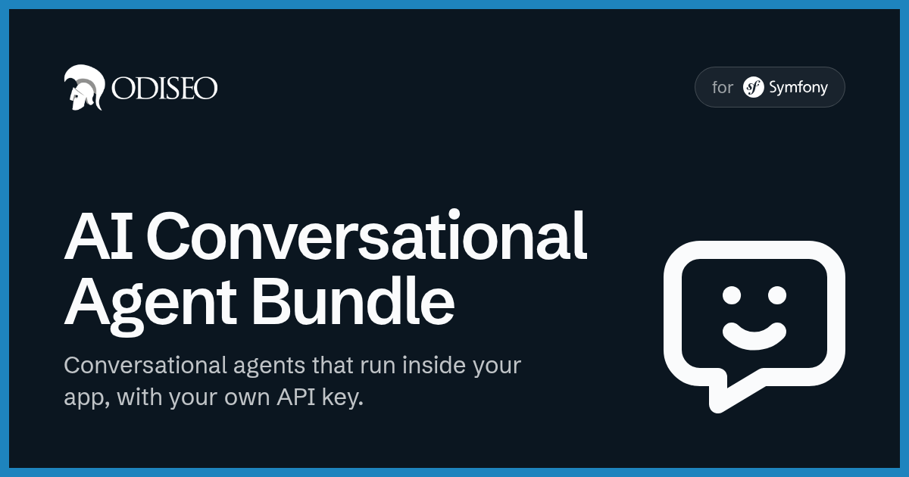

<p align="center">
    <a href="https://odiseo.io/en?utm_source=github&utm_medium=readme&utm_campaign=ai-conversational-agent-bundle" target="_blank">
        
    </a>
</p>
<p align="center">
    <a href="https://packagist.org/packages/odiseoteam/ai-conversational-agent-bundle"></a>
    <a href="https://packagist.org/packages/odiseoteam/ai-conversational-agent-bundle"></a>
    <a href="https://github.com/odiseoteam/ai-conversational-agent-bundle/actions/workflows/build.yml"></a>
    
    
    <a href="LICENSE"></a>
</p>

## Introduction

A vertical-agnostic core for conversational agents in Symfony: the turn loop, tool execution,
gates, sessions, streaming, memory, budgets and evals. Verticals (a shopping assistant, an
institutional assistant) are built on top of it as capabilities.

> [!TIP]
> Based on Anthropic's guide to building shopping and merchant agents,
> **[The anatomy of effective commerce agents](https://claude.com/resources/articles/the-anatomy-of-effective-commerce-agents)**.

### Features

- ✅ **Streaming** - Model rounds, tool calls and UI components are sent as server-sent events while the model writes
- ✅ **Tool validation** - Arguments are checked against each tool's JSON schema, writes and cards accept only ids a tool returned, and grounding rules force a lookup when a message matches a lexicon
- ✅ **Fencing** - Site content, tool results and memory are sanitized and passed to the model as data, never as instructions
- ✅ **Memory** - Facts about the visitor are extracted after the turn by a second, cheaper model, with identifiers and credentials filtered out
- ✅ **Budgets** - Spend caps per session, per client and per day, rate limits on the endpoints and a ledger of every call's cost
- ✅ **Rules and knowledge** - House rules go in the cached prompt; policies and guides are searched by section, from Markdown files or other sources
- ✅ **Models** - Claude or OpenAI per role (turn, memory, judge) through Symfony AI, or a custom adapter
- ✅ **Evals** - JSON cases run against the live model, graded by code and by a judge model, with trials and replays

## Getting Started

### Install it in 4 steps ⚡

1. ✅ Require the bundle
2. ✅ Connect Claude or OpenAI through Symfony AI
3. ✅ Import the routes and map the Doctrine entities
4. ✅ Register a capability with your tools

**[👉 Follow the installation guide](doc/installation.md)**

### Quick Example

```bash
composer require odiseoteam/ai-conversational-agent-bundle symfony/ai-bundle symfony/ai-anthropic-platform
```

A capability gives the agent its tools. Any autoconfigured service implementing
`CapabilityInterface` is picked up:

```php
use Odiseo\AiConversationalAgentBundle\Capability\CapabilityInterface;
use Odiseo\AiConversationalAgentBundle\Capability\ToolContext;
use Odiseo\AiConversationalAgentBundle\Capability\ToolSpec;
use Odiseo\AiConversationalAgentBundle\Streaming\ToolOutcome;

final class OpeningHoursCapability implements CapabilityInterface
{
    public function name(): string
    {
        return 'store.hours';
    }

    public function tools(): array
    {
        return [new ToolSpec('get_opening_hours', "Today's opening hours.", [
            'type' => 'object',
            'properties' => [],
            'additionalProperties' => false,
        ])];
    }

    public function promptFragments(): array { return []; }
    public function groundingRules(): array { return []; }
    public function components(): array { return []; }

    public function execute(string $tool, array $input, ToolContext $context): ToolOutcome
    {
        return new ToolOutcome('Open today from 9:00 to 18:00.');
    }
}
```

Then talk to it from the terminal:

```bash
bin/console agent:chat
```

> [!IMPORTANT]
> Set `cache_retention: none` on the Anthropic platform. The bundle places its own cache
> breakpoints, and the bridge's default adds more on top that the next rounds cannot read. See
> [Installation](doc/installation.md#2-connect-a-model-provider).

## Documentation

- 📦 **[Installation](doc/installation.md)** - The bundle, the model provider, the routes and the Doctrine entities
- 🧩 **[Concepts and extension points](doc/concepts.md)** - Capabilities, gates, sessions and every port a host can replace
- 🤖 **[Models and providers](doc/models.md)** - A model per role, prices, capabilities and your own adapter
- 📏 **[Rules](doc/rules.md)** - The organisation's house rules, their order, caps and sources
- 📚 **[Knowledge](doc/knowledge.md)** - Markdown files, the lexical search, other sources and the guide index
- ⚙️ **[Runtime changes](doc/runtime-changes.md)** - Settings, API keys, spend scopes and versions edited without a deploy
- 🗂️ **[Logging and retention](doc/operations.md)** - The `conversational_agent` channel and `agent:prune`
- 🧪 **[Evals](doc/evals.md)** - Cases, graders, trials and replays with `agent:eval`
- 🤝 **[Contributing](CONTRIBUTING.md)** - Running the checks and the suite on a real database

## Compatibility

| Bundle | PHP | Symfony | Database | Model |
| ------ | --- | ------- | -------- | ----- |
| `0.x` | 8.2 · 8.3 · 8.4 | 7.3 · 7.4 · 8.x | Any Doctrine ORM platform; CI covers SQLite, MySQL and PostgreSQL | Claude or OpenAI, through Symfony AI; or your own `ModelProviderInterface` |

The bundle is in `0.x`: minor versions may break the API until `1.0`.

## Professional Support

This bundle is maintained by [Odiseo](https://odiseo.io/en?utm_source=github&utm_medium=readme&utm_campaign=ai-conversational-agent-bundle). Want an agent built on it, or help with any Symfony or Sylius project?

- 🎬 **[Live walkthrough](https://odiseo.io/en/contact-us?utm_source=github&utm_medium=readme&utm_campaign=ai-conversational-agent-bundle)** - A live tour of the bundle and what runs on it
- 🛠️ **[Symfony and Sylius development](https://odiseo.io/en/contact-us?utm_source=github&utm_medium=readme&utm_campaign=ai-conversational-agent-bundle)** - Help building your own agent or any other project
- 🔌 **[Sylius plugins](https://odiseo.io/en/products/sylius-plugins?utm_source=github&utm_medium=readme&utm_campaign=ai-conversational-agent-bundle)** - Browse all our plugins

## License

[MIT](LICENSE).
